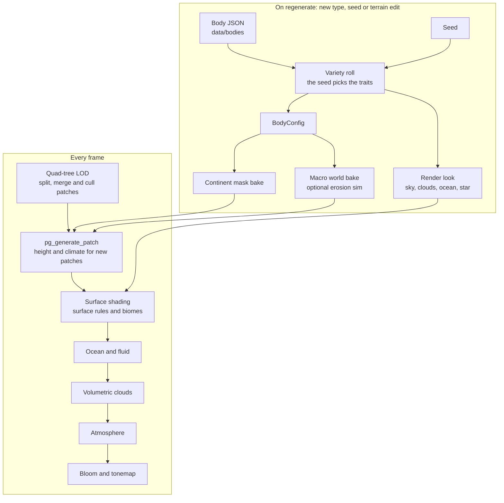
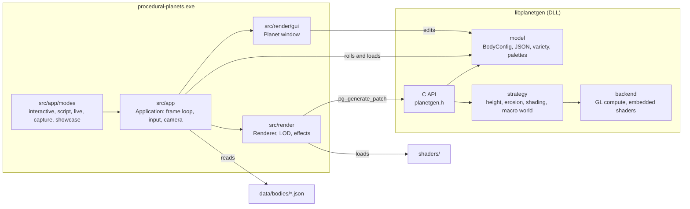

# Procedural Planets

A GPU-accelerated procedural planet renderer built with C++17 and OpenGL. Generates Earth and 12 sci-fi planet types (dune, ice, ocean, toxic, lava, crystal and more) with terrain, biomes, oceans, a scattering atmosphere and volumetric clouds, all driven by compute shaders and procedural noise. You can fly from orbit down to the ground without a loading step.

<p align="center">
  
</p>

Inspired by [Sebastian Lague's Solar System](https://github.com/SebLague/Solar-System). The architecture and implementation are built from scratch in C++/OpenGL, but studying his approach helped shape the direction of this project.

> **A note on the rendering code:** I'm not a graphics developer — I understand the rendering pipeline at a high level but not the low-level details. The rendering parts (shaders, GPU compute, the OpenGL pipeline) were built with AI assistance (Claude). The overall architecture, the library design, and the rest of the codebase are my own.

## Gallery

<p align="center">
  
</p>

<p align="center">
  
</p>

<p align="center">
  
</p>

<p align="center">
  
</p>

## Macro World Layer

An optional once-per-body bake on a coarse cube-sphere grid. It adds tectonic plates (mountain belts on convergent boundaries, rifts on divergent ones), hydraulic erosion, rivers that always drain to the sea, and moisture carried by prevailing winds (wet coasts, dry interiors, rain shadows). The terrain samples it as its base height and the climate model reads its moisture. The bake takes about 0.25 s on a desktop GPU.

Turn it on in the Planet window: **Terrain > Erosion Sim (slow) > Erosion Sim** (needs Tectonic Plates). In a body JSON, set `"macroWorld": { "enabled": true }`. It is off by default. Its river carving still shows as stair-stepped streaks up close, which is why it is not on for Earth yet.

## Features

**Terrain and generation**
- **GPU Compute Terrain** — Height and shading generated in compute shader passes, entirely on the GPU
- **Async Generation** — Non-blocking terrain generation with a priority scheduler and GPU fence synchronization
- **Icosahedron LOD** — A quad-tree of spherical patches that split and merge with camera distance (max depth adjustable up to 12), with geomorphing so patches don't pop
- **Tectonic Plates** — Voronoi-based plate boundaries with convergent mountains and divergent rifts
- **Multi-Layer Noise** — Simplex and fractal noise with octaves, lacunarity, persistence, and ridge noise, plus fine relief that only shows up close
- **libplanetgen** — Standalone shared library (DLL) with C API for terrain generation, usable from Unity, Unreal, or any C/C++ consumer

**Ground**
- **Biomes** — Whittaker biome colours (tropical, temperate, boreal, tundra, ice) from temperature and moisture, read from a JSON palette per body
- **Generated Material Textures** — Rock, grass, sand, snow and soil textures generated from the planet seed at load (no image files), sampled triplanar at two scales so no tiling shows
- **Detail by Distance** — Colour and bump detail are added as you fly closer, based on how big a pixel is on the ground, so close-ups stay sharp and far views don't shimmer

**Water, sky and clouds**
- **Ocean** — Real water depth from the terrain, light absorption from shallow turquoise to deep blue, waves that keep their size at any planet radius, sun glitter, and a reflection of the actual sky
- **Atmosphere** — Rayleigh and Mie scattering with phase functions, an earth shadow, blue daytime sky, red sunsets and a real-size sun disc
- **Volumetric Clouds** — A raymarched cloud layer with a weather map, 3D noise, self-shadowing and a silver lining toward the sun; you can fly through it. The clouds cast shadows on the ground
- **HDR Rendering** — The scene renders in HDR with an exposure control, a tonemap that keeps highlight colour, and bloom around the sun and glints

**App**
- **Planet Types** — Earth plus dune, ice, ocean, toxic, barren, salt flats, alien lush, swamp, lava, eye (tidally locked), city and crystal. A type is one JSON file in `data/bodies`: palette, sky, weather, star colour, fluid (water, ice, lava, acid), terrain style (dunes, craters, terraces, canyons, spires) and climate traits
- **Surface Rules** — Every rule of the surface shader is a field in the type's `render.surface` block: material colours, where rock, sand, snow and soil take over, detail, per-material texture tiling and bump, plus realism layers (rock strata, wet ground, sediment, vegetation by slope and treeline, an ash/frost/dust cover, sky-tinted shadows), all editable under Surface > Surface Rules. Earth and every planet type use them
- **Reroll** — One click gives a new seed: a planet type rolls palette, sky, weather and terrain style from its `variety` block and the seed; Earth gets new continents. Locked tabs keep their values
- **Cinematic System** — Turntable camera (F5) and headless capture: single screenshots, turntable frame sequences, and a showcase that cycles through random worlds
- **Instrument Mode** — Script the camera and any setting from a JSON timeline (`--script`) or a live socket (`--live`), and capture frames; the README media is rendered this way
- **Live Tweaking** — One Planet window with seven tabs and a tooltip on every setting

<p align="center">
  
  
</p>

## Building

You'll need CMake 3.20+, a C++17 compiler, and OpenGL 4.5+ support. All dependencies are pulled in automatically — no manual setup needed.

```bash
git clone https://github.com/AcKeskin/procedural-planets.git
cd procedural-planets
cmake -B build -DCMAKE_BUILD_TYPE=Release
cmake --build build --config Release
```

The executable ends up in `build/bin/Release/`. The `planetgen.dll` shared library is built alongside, and `shaders/` and `data/` are copied next to the exe. Start it from that folder (double-clicking does this); it loads `shaders/` and `data/` relative to the working directory.

Run the tests (they need a GPU; they use a hidden window) with:

```bash
ctest --test-dir build -C Release
```

## Dependencies

Everything is handled through CMake FetchContent, so you don't need to install anything manually.

| Library | Version | Purpose |
|---------|---------|---------|
| [GLFW](https://github.com/glfw/glfw) | 3.4 | Window and input |
| [GLM](https://github.com/g-truc/glm) | 1.0.1 | Mathematics |
| [ImGui](https://github.com/ocornut/imgui) | docking | Debug GUI |
| [gl3w](https://github.com/skaslev/gl3w) | latest | OpenGL loader |
| [stb](https://github.com/nothings/stb) | latest | Image loading and PNG export |
| [nlohmann/json](https://github.com/nlohmann/json) | 3.11.3 | JSON parsing |
| [Catch2](https://github.com/catchorg/Catch2) | 3.6.0 | Tests |

## Controls

Press `F1` in the app for the same key list. It opens once on first launch.

| Group | Input | Action |
|-------|-------|--------|
| Camera | `LMB` drag | Orbit the planet (carries on over the poles) |
| | `Wheel` | Zoom in steps scaled to the altitude (Orbit), or set the fly speed (Fly) |
| | `W A S D` | Fly forward, left, back, right. In Orbit this switches to Fly |
| | `Q / E` | Fly down / up |
| | `RMB` drag | Look around. In Orbit this switches to Fly |
| | `Shift` / `Ctrl` | Faster x4 / slower x0.25 |
| | `G` | Switch Orbit / Fly (Orbit is the default) |
| | `O` | Auto-rotate |
| | `F` | Frame the planet |
| | `Home` | Reset the view |
| | Double-click | Fly to that point |
| | `Ctrl + 1 .. 9` | Save a bookmark (camera and sun direction) |
| | `1 .. 9` | Go to a bookmark |
| Planet | `R` | Reroll: new seed |
| | `H` | Atmosphere on / off |
| View | `Tab` | Hide / show the Planet window |
| | `F1` | Help |
| | `F5` | Play / stop the turntable. By default it turns until you press `F5` or `Esc` |
| | `F12` | Screenshot (PNG) |
| | `Esc` | Close help, then stop the turntable. Hold 1 s to quit |

### Planet window

All settings live in one docked Planet window with seven tabs. Every control has a tooltip.

<p align="center">
  
</p>

- **Terrain** - shape, continents, mountains, tectonic plates, sea floor, terrain style and the erosion sim
- **Surface** - materials, climate, surface rules and textures
- **Ocean** - sea level, water, waves, fluid and seabed colour
- **Sky** - atmosphere, haze and clouds
- **Light** - sun, shadows and night lights, camera exposure
- **Camera** - view, orbit motion and the turntable
- **System** - frame stats and mesh detail (LOD)

The top bar shows the planet type, the seed, a Reroll button, the camera mode, altitude and speed, and the frame time.

The five look tabs (Terrain, Surface, Ocean, Sky, Light) each have Lock, Randomize, Reset and an "N edited" count:

- **Lock** keeps the tab's values on Reroll. A locked Terrain tab still takes its land shape from the seed.
- **Randomize** gives new values to this tab only. The seed stays.
- **Reset** sets the tab back to the type's values at the current seed.
- Edited values show in amber. Right-click a value for Reset value, Copy and Paste.
- An amber `*` after the seed means the seed alone no longer gives this planet: a tab is locked, edited or randomized.
- Reroll gives every unlocked tab the type's values at a new seed.
- A type switch keeps only a locked Light tab. The other tabs take the new type's values.

### Command line

Without arguments the app opens the interactive window. These flags run it headless or scripted:

| Flag | What it does |
|------|--------------|
| `--screenshot <path>` | Render a few warm-up frames, write one PNG, exit. Takes `--seed`, `--width`, `--height`, `--camera x,y,z`, `--light x,y,z`, `--frames` |
| `--cinematic --out-pattern <out/f_%04d.png>` | Render a turntable as a PNG sequence (`--cinematic-frames`, `--fps`, `--orbit-speed`) |
| `--showcase --out-pattern <...>` | Orbit while generating a new random world every few seconds (`--planets`, `--hold-frames`) |
| `--script <timeline.json>` | Run a JSON timeline of camera moves, setting changes and captures (samples in `data/scripts/`) |
| `--live [port]` | Open the window and accept the same JSON commands over a local socket (default port 8787) |

## Project Structure

```
src/                    The showcase app — frame loop, LOD, rendering, GUI
├── core/               Platform-independent logic
│   ├── math/           Camera system
│   └── noise/          Simplex and fractal noise
├── render/             GPU rendering pipeline
│   ├── lod/            Icosahedron patch quad-tree (PlanetQuadTree, SpherePatch, PatchPool)
│   ├── effects/        Atmosphere, clouds, ocean, bloom and ground texture passes
│   ├── materials/      CPU generators for the ground textures and the cloud noise
│   ├── settings/       Typed configuration structs
│   ├── gui/            The Planet window and its tabs, which edit the active body's config
│   ├── cinematic/      Turntable controller + screenshot capture
│   ├── Renderer             Multi-pass HDR scene draw (space → planet → ocean → clouds + atmosphere → tonemap)
│   ├── BodyRuntime          Render-time view of the active body (no subclassing)
│   └── GenerationScheduler  Async compute dispatch with GPU fence sync
└── app/                Application entry, input handling, headless capture
    └── instrument/     --script / --live command timelines and parameter registry

libplanetgen/           Standalone terrain generation library (DLL)
├── include/planetgen/  Public C API + C++ RAII wrapper; model/ = C++ body model API (BodyConfig, JSON, variety, palettes)
├── src/api/            C API implementation
├── src/model/          Body model implementation
├── src/strategy/       GenerationPipeline + Height/Erosion/Shading strategies, macro world bake
├── src/backend/        Compute backend abstraction
│   └── opengl/         OpenGL 4.5 compute implementation
└── cmake/              Shader embedding build tools

shaders/
├── compute/            GPU terrain generation (height, shading, erosion)
├── includes/           Shared GLSL libraries (noise, lighting, sky scattering, cloud layer, ground materials, tonemap)
├── earth/              Surface rendering shared by every body
├── atmosphere.*        Atmospheric scattering and the final composite
├── clouds_march.frag   Volumetric cloud raymarch
├── ocean.*             Ocean surface
└── space.*             Background rendering

data/
├── bodies/             Earth and the planet types, one JSON each (earth.json, dune.json, lava.json, ...)
├── palettes/           Built-in library palettes (earth, volcanic, crystalline)
└── scripts/            Sample instrument timelines for --script
```

## How it works

How a planet is made, from the type's JSON to a frame:



Code layout, and who calls whom:



## Architecture

### Body Type System

A body is **data, not a subclass**. The canonical definition is `BodyConfig` (in `libplanetgen/src/model/`) — a typed struct of blocks (shape, tectonics, ocean floor, shading, palette, shader paths) loaded from `data/bodies/*.json`. It is the single source of truth for what a body is.

The app wraps the active config in a `BodyRuntime` — a render-time *adapter* (no inheritance) that exposes metadata, shader paths, and render-uniform binding. The Planet window edits the config in place; any edit rebuilds the body so its continent mask re-bakes.

New planet types are added by creating a JSON file in `data/bodies` (its palette, sky, fluid, terrain style and variety live in it). No code changes required.

### libplanetgen

A standalone shared library that owns the GPU compute terrain pipeline as a reusable DLL:
- **C API** (`planetgen.h`) — opaque handles for context, body, and result; designed for C# P/Invoke and FFI
- **Strategy pipeline** — `GenerationPipeline` runs fixed per-stage strategies (Height → Erosion → Shading → Palette); each stage is an interface, so a new stage is a new class, not a fork
- **Embedded shaders** — compute shaders baked into the DLL at build time, no runtime file dependencies
- **Backend abstraction** — `IComputeBackend` interface allows future Vulkan support without API changes
- **Dual context mode** — reuses host app's GL context or creates a headless GLFW window

The app drives terrain through the library's **per-patch** entry point (`pg_generate_patch`): the same per-vertex strategies as the whole-mesh path, writing GPU-resident into the app's own LOD buffers, with no erosion (it is neighbour-coupled and would seam at patch boundaries). The app's `GenerationScheduler` owns the async dispatch and GPU fence sync.

### Generation Pipeline

1. **Patch Generation** — An icosahedron is subdivided into spherical patches projected onto a unit sphere
2. **Async Scheduling** — Patches are queued into a priority scheduler that dispatches compute work across frames with GPU fence synchronization
3. **Height Pass** — A compute shader generates terrain elevation from layered noise (continents, mountains, tectonic plates, ocean floor topology)
4. **Shading Pass** — Another compute shader computes per-vertex climate data (temperature, moisture) or palette parameters
5. **LOD Selection** — Each frame, patches pick their detail level based on distance and get culled if outside the view
6. **Surface Rendering** — One shared fragment shader applies the body's biome palette, generated material textures and planet type traits, with lighting and cloud shadows
7. **Ocean** — Drawn on the terrain's own patches at sea level, coloured by real water depth and reflecting the sky
8. **Clouds and Atmosphere** — The cloud layer is raymarched at half resolution, then the atmosphere pass composites it with the scene and adds scattering along each view ray. Both use the same sky model (`sky_radiance.glsl`), as does the ocean reflection
9. **Tonemap** — The HDR image gets exposure, bloom and a tonemap before the UI is drawn

## References

- [Sebastian Lague — Solar System](https://github.com/SebLague/Solar-System) — studied for compute-based terrain generation approach
- [Jujedie — PlanetGenerator](https://github.com/Jujedie/PlanetGenerator) — the macro world's erosion passes are ported from it (MIT, see `third_party/NOTICE-PlanetGenerator.md`)
- [Inigo Quilez — Smooth Min/Max](https://iquilezles.org/articles/smin/) — polynomial smooth blending functions
- [Ben Golus — Triplanar Shader](https://bgolus.medium.com/normal-mapping-for-a-triplanar-shader-10bf39dca05a) — triplanar mapping with reoriented normal blending
- [Andrew Schneider — The Real-time Volumetric Cloudscapes of Horizon Zero Dawn](https://www.guerrilla-games.com/read/the-real-time-volumetric-cloudscapes-of-horizon-zero-dawn) — weather map, Perlin-Worley noise and the powder term for the clouds
- [Sébastien Hillaire — Physically Based Sky, Atmosphere and Cloud Rendering in Frostbite](https://www.ea.com/frostbite/news/physically-based-sky-atmosphere-and-cloud-rendering) — energy-conserving scattering integration and multiple-scattering approximation

## License

[MIT](LICENSE)
